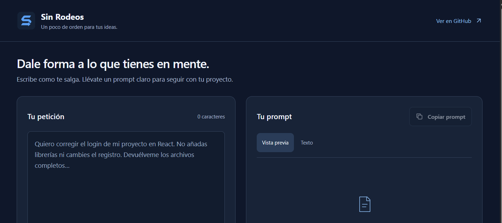
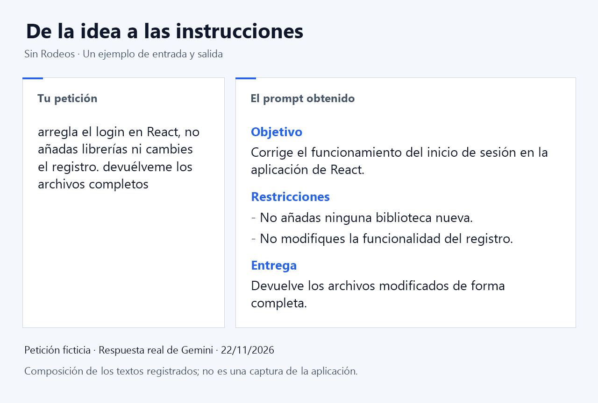
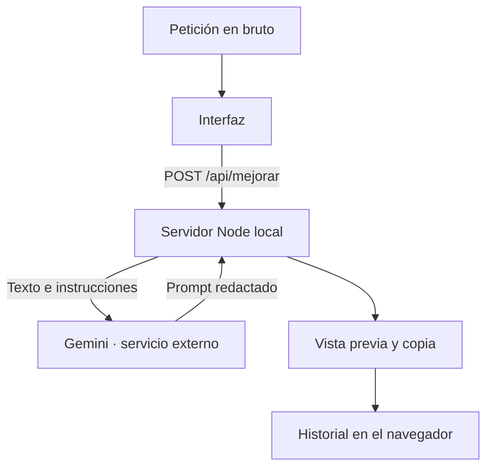

# Sin Rodeos

**Escribe como te salga. Llévate un prompt claro para seguir con tu proyecto.**

Sin Rodeos convierte peticiones desordenadas en instrucciones en español, con especial atención a proyectos y código. Busca mejorar la redacción y la estructura conservando lo que has pedido.

Proyecto personal desarrollado **principalmente con IA**. Mi aportación está en identificar el problema, definir lo que necesitaba, probar el resultado y pedir correcciones.

[Conocer el proyecto](docs/PROYECTO.md) · [Probarlo en tu equipo](#cómo-probarlo) · [Código del servidor](servidor.js)



*Vista de la interfaz en escritorio. Captura real facilitada por el autor; se ha retirado únicamente el marco de Windows. Muestra el estado inicial, sin una generación en curso.*

## Por qué lo creé

Empecé Sin Rodeos mientras hacía otros proyectos con ayuda de IA. Muchas veces el resultado no coincidía con lo que quería, o me costaba explicar bien mis ideas. Me puse a investigar y decidí crear una herramienta que me ayudara a convertir esas peticiones en instrucciones más claras.

La idea es poder escribir deprisa y obtener una petición ordenada que pueda revisar y pegar en otra IA. El reto principal es conservar los requisitos al reformularlos: una respuesta más bonita pierde utilidad si cambia lo que quería hacer.

## Un ejemplo de uso

**Petición ficticia con respuesta real de Gemini**, registrada el 22 de noviembre de 2026. La imagen compara los textos; no es una captura de la aplicación.

<picture>
  <source media="(max-width: 640px)" srcset="docs/imagenes/ejemplo-movil.png">
  
</picture>

<details>
<summary>Leer la entrada y la salida en texto</summary>

Entrada:

```text
arregla el login en React, no añadas librerías ni cambies el registro. devuélveme los archivos completos
```

Respuesta real:

```markdown
## Objetivo
Corrige el funcionamiento del inicio de sesión en la aplicación de React.

## Restricciones
- No añadas ninguna biblioteca nueva.
- No modifiques la funcionalidad del registro.

## Entrega
Devuelve los archivos modificados de forma completa.
```

Se conservan las restricciones sobre bibliotecas y registro, y la entrega de archivos completos. Este ejemplo individual no demuestra que todas las respuestas mantengan todos los requisitos. [Datos y procedencia](docs/imagenes/README.md).

</details>

## Mi aportación y el uso de IA

La mayor parte del código se generó con IA. Yo identifiqué la necesidad, expliqué qué debía hacer la herramienta, probé las versiones y pedí cambios cuando algo fallaba o no encajaba con lo que buscaba.

| Uso de IA | Cómo interviene |
| --- | --- |
| Durante el desarrollo | Utilicé varios modelos a través de [OmniRoute](https://github.com/cheaper-inference/OmniRoute). Las mejoras posteriores y esta documentación se trabajaron con Codex. El logo actual se generó con ImageGen; su [procedencia y prompts](logo.png.json) se conservan. |
| Dentro de la aplicación | Gemini redacta el prompt a través del servidor local. OmniRoute no forma parte del funcionamiento de la aplicación. |

El proyecto muestra cómo he llevado una necesidad propia a una herramienta que puedo probar e ir corrigiendo. [El caso de estudio](docs/PROYECTO.md) explica el proceso y sus límites con más detalle.

## Cómo funciona

La interfaz usa **HTML, CSS y JavaScript**, sin frameworks. El servidor utiliza **Node.js y sus módulos nativos**. La aplicación no necesita dependencias de npm.



Puedes elegir **Preciso, Directo, Analítico o Creativo**, ver el Markdown original, copiarlo, cancelar una generación y recuperar las diez últimas entradas del historial local.

Tres decisiones de la implementación:

| Decisión | Motivo |
| --- | --- |
| Llamar a Gemini desde el servidor | La clave se lee desde `.env` y se usa para autenticarse ante Google; nunca se entrega al navegador. El texto sí se envía a Google. |
| Separar generación y revisión orientativa | Gemini redacta; una comprobación aproximada señala posibles omisiones o cambios sin sustituir el resultado ni bloquearlo. |
| Crear la vista previa con nodos del DOM | Mostrar títulos y listas sin insertar el texto generado como HTML ejecutable; la copia conserva el Markdown original. |

## Problemas abordados y estado actual

Las iteraciones han tratado la conservación de negaciones, cifras y requisitos; la cancelación y el descarte de respuestas antiguas; y la protección de archivos privados mediante un servidor limitado al equipo local y a archivos públicos autorizados.

**Verificación del 24 de noviembre de 2026: 31/31 pruebas automáticas superadas.** Cubren lógica, servidor y eventos con un DOM de prueba. No garantizan la calidad semántica de las respuestas ni sustituyen una revisión visual en un navegador real.

Límites que siguen abiertos:

- La comprobación de conservación es aproximada: puede omitir errores o avisar por una reformulación válida. Hay que revisar el prompt.
- La aplicación depende de la conexión, la cuota y la disponibilidad de Gemini.
- La comparación real del 22 de noviembre completó **11 de 12 pares**; el último falló por disponibilidad del proveedor. Quedan completar ese caso y la evaluación cualitativa del conjunto. No hay una mejora medida publicada.
- La revisión visual completa en escritorio y móvil sigue pendiente. La captura compartida documenta una vista de la interfaz.

El historial permanece en `localStorage` del navegador y puede borrarse desde la app. No hay analíticas externas ni modo sin conexión. Evita introducir datos sensibles: el texto sale al proveedor.

## Cómo probarlo

Necesitas Node.js, conexión a internet y una clave de Gemini. Verificado con Node.js **v24.21.0**.

```powershell
git clone https://github.com/qirris/SinRodeos.git
cd SinRodeos
Copy-Item .env.example .env
```

Configura `GEMINI_API_KEY` en tu `.env` local, sin compartirla ni subirla a GitHub. Después:

```powershell
npm start
```

Abre [la aplicación local](http://127.0.0.1:8000). En Windows, `abrir.bat` permite abrirla en una ventana de app. No hace falta ejecutar `npm install`.

Para comprobar el código, ejecuta `npm test`. Para actualizar una copia existente, guarda tu trabajo y usa `git pull --ff-only` en esa carpeta; reinicia su servidor si cambió el código. Una actualización solo documental no requiere reiniciarlo.

Más información: [caso de estudio](docs/PROYECTO.md) · [arquitectura](instrucciones/ARQUITECTURA.md) · [pruebas y comparación real](instrucciones/PRUEBAS.md) · [procedencia de las imágenes](docs/imagenes/README.md).
