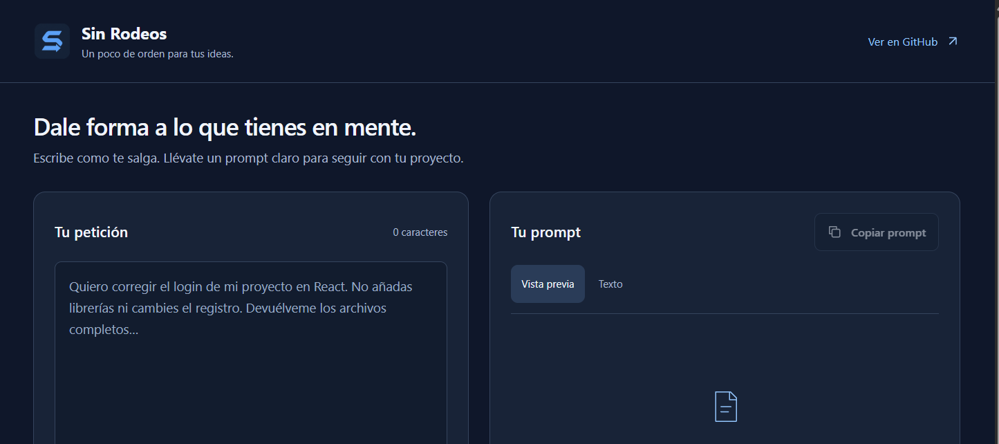

# Sin Rodeos: de una dificultad propia a una herramienta

Sin Rodeos es un proyecto personal para convertir peticiones escritas deprisa en prompts más claros en español. Esta página explica por qué lo empecé, qué aporté y qué se puede comprobar hoy en el repositorio.

[Volver al README](../README.md) · [Ver el ejemplo real](#un-ejemplo-concreto) · [Consultar la arquitectura](../instrucciones/ARQUITECTURA.md)

## El problema del que partí

Mientras hacía otros proyectos con ayuda de IA, muchas veces el resultado no coincidía con lo que quería. En ocasiones la IA no seguía mis indicaciones; en otras, me costaba explicar bien lo que tenía en mente. Me puse a investigar y decidí crear una herramienta que me ayudara a formular esas peticiones con más claridad.

La necesidad era concreta: escribir con mis propias palabras, incluso con faltas o desorden, y obtener instrucciones que pudiera revisar y reutilizar. La prioridad del producto es conservar el contenido y mejorar la forma. Una restricción como «no cambies el registro» debe seguir estando presente después de reformular la petición.

Esa prioridad es un objetivo de diseño, no una garantía de que un modelo vaya a cumplir siempre. Por eso la aplicación incorpora avisos orientativos y mantiene el resultado visible para revisarlo antes de copiarlo.

## Qué hice yo y qué hizo la IA

La mayor parte del código se generó con IA. Mi aportación fue identificar la necesidad, explicar qué debía hacer la herramienta, probar las versiones y pedir correcciones cuando algo no funcionaba o se alejaba de lo que buscaba.

Durante el desarrollo utilicé varios modelos mediante [OmniRoute](https://github.com/cheaper-inference/OmniRoute). Las mejoras posteriores del proyecto, las comprobaciones y esta documentación se trabajaron con Codex. El logo actual se generó con ImageGen; se conservan la imagen y sus [prompts y procedencia](../logo.png.json).

Mi papel fue dirigir esas iteraciones desde el uso de la herramienta: indicar el resultado esperado, observar qué faltaba y pedir ajustes. El código y las pruebas quedan disponibles para que cualquiera pueda examinar el resultado.

Hay dos usos distintos de IA:

| Momento | Herramientas y función |
| --- | --- |
| Construcción del proyecto | Modelos a través de OmniRoute, Codex en mejoras posteriores e ImageGen para el logo. Generación y revisión de código, documentación y recursos, con indicaciones y pruebas de uso por mi parte. |
| Uso de Sin Rodeos | Gemini recibe la petición y las instrucciones del producto desde el servidor Node local y devuelve el prompt redactado. OmniRoute no es una dependencia de la aplicación. |

## Qué permite hacer

La interfaz reúne la petición y el resultado en dos paneles. Ofrece cuatro estilos: **Preciso** adapta la estructura a la petición; **Directo** busca brevedad conservando requisitos; **Analítico** organiza el trabajo; y **Creativo** permite una redacción más expresiva sin pedir ideas nuevas.

El resultado tiene una vista previa y una vista de texto. Se puede copiar el Markdown original, cancelar una generación o recuperar las últimas diez entradas del historial del navegador. Las notas `[Aclarar: …]` están previstas para datos imprescindibles que falten; no deberían convertirse en requisitos inventados.



*Captura real compartida por el autor. Solo se ha recortado el marco de Windows. No muestra una respuesta generada ni acredita una revisión visual completa.*

## Un ejemplo concreto

El siguiente caso utiliza una **petición ficticia con respuesta real de Gemini**, registrada el 22 de noviembre de 2026 durante la comparación de instrucciones. El registro no identifica el modelo concreto utilizado, por lo que no se le atribuye uno.

Entrada:

```text
arregla el login en React, no añadas librerías ni cambies el registro. devuélveme los archivos completos
```

Salida registrada:

```markdown
## Objetivo
Corrige el funcionamiento del inicio de sesión en la aplicación de React.

## Restricciones
- No añadas ninguna biblioteca nueva.
- No modifiques la funcionalidad del registro.

## Entrega
Devuelve los archivos modificados de forma completa.
```

En este caso se separan objetivo, restricciones y entrega. Se mantienen React, la prohibición de añadir bibliotecas, la de modificar el registro y la petición de archivos completos. La herramienta redacta instrucciones; no corrige el código del login.

La [comparativa visual](imagenes/ejemplo.png) representa esos textos, no una pantalla de ejecución. El [extracto público](imagenes/ejemplo.json) contiene solo este caso ficticio. No se publica el informe completo de trabajo ni contenido del historial del usuario.

## Cómo está construido

La aplicación usa HTML, CSS y JavaScript con módulos ES. El servidor utiliza módulos nativos de Node.js; no hay frameworks ni dependencias de npm necesarias para ejecutarla. En Windows puede abrirse en una ventana de app mediante `abrir.bat`, sin Electron.

El recorrido de una petición es:

1. La interfaz recoge el texto y el estilo elegido.
2. Envía `{ texto, estilo }` a `POST /api/mejorar` en el servidor local.
3. El servidor lee la configuración privada, añade las instrucciones del producto y llama a Gemini.
4. Devuelve `{ prompt }` o un error en español. La interfaz descarta respuestas que ya no correspondan a la petición vigente.
5. El resultado se muestra, se revisa de forma orientativa y queda disponible para copiar o recuperar en el historial local.

El texto **se envía a Google**. La clave de `.env` se utiliza desde el servidor para autenticarse ante el proveedor y nunca se entrega al navegador. El historial se guarda en `localStorage`, no en un servicio de historial externo.

Tres decisiones ayudan a entender la implementación:

| Decisión | Por qué está ahí | Dónde se puede revisar |
| --- | --- | --- |
| Servidor local entre navegador y Gemini | Evitar entregar la clave al navegador y centralizar validación, límites y errores del proveedor. | [servidor.js](../servidor.js) |
| Separar redacción y conservación | El modelo redacta; la revisión orientativa busca posibles pérdidas sin reemplazar el prompt por una plantilla. La comparación de palabras no puede garantizar equivalencia semántica. | [instrucciones.js](../logica/instrucciones.js), [mejorador.js](../logica/mejorador.js) |
| Construir la vista previa con nodos seguros | Presentar títulos y listas sin ejecutar el resultado como HTML, conservando el texto original al copiar. | [vista.js](../logica/vista.js), [app.js](../app.js) |

## Problemas abordados en las iteraciones

**Conservar la petición al reformular.** Se revisaron las instrucciones de los cuatro estilos para evitar sugerencias añadidas, recortes arbitrarios y estructuras que no encajaran. La comprobación orientativa observa coincidencias de contenido, negaciones y elementos como cifras, rutas o código. Puede dar avisos incorrectos y dejar pasar cambios de significado: sigue siendo necesaria la revisión humana.

**Cancelar sin que aparezca una respuesta antigua.** La implementación incorpora cancelación y una comprobación de la petición vigente antes de mostrar el resultado. El servidor también interrumpe la llamada al proveedor cuando se desconecta el cliente. Hay pruebas de estos casos, además de un tiempo máximo de generación.

**Evitar exponer la configuración privada.** El servidor escucha en `127.0.0.1`, sirve una lista explícita de archivos públicos y valida las peticiones. `.env`, `.git` y los documentos internos no se sirven como recursos de la app. Estas medidas tienen pruebas concretas; no equivalen a una auditoría de seguridad completa.

**Presentar la respuesta de forma útil.** La vista previa conserva numeración y anidación de listas. La copia utiliza el Markdown original, evitando que el formato visual cambie el texto entregado.

Estas soluciones se implementaron con asistencia de IA. Mi aportación fue señalar el comportamiento que necesitaba y pedir iteraciones; el repositorio permite revisar cómo quedó resuelto.

## Evidencias y límites actuales

| Comprobación | Resultado y alcance |
| --- | --- |
| Pruebas automáticas, 24/11/2026 | **31/31 superadas** con `npm test`. Cubren lógica, servidor y eventos de interfaz con un DOM de prueba. |
| Comparación real, 22/11/2026 | **11 de 12 pares completados** con peticiones ficticias y dos variantes de instrucciones. El último falló por disponibilidad del proveedor. |
| Muestra pública de respuesta | El caso de login reproducido arriba proviene de ese registro real. Es una muestra individual, no una métrica de mejora. |
| Imágenes | Una captura real proporcionada por el autor y una composición de entrada/salida. No hay pantallas de funcionamiento inventadas. |
| Revisión visual | La revisión completa de escritorio y móvil sigue pendiente, igual que la confirmación del favicon de Windows tras reabrir. |

Para repetir las pruebas no hace falta una clave:

```powershell
npm test
```

La comparación real es opcional:

```powershell
npm run comparar -- --real
```

Este segundo comando usa la configuración privada y puede realizar hasta 24 llamadas, consumir cuota y fallar si el proveedor no está disponible. Guarda el informe de trabajo en una ruta ignorada por git. No calcula una puntuación semántica; los resultados necesitan evaluación manual. [Detalle del procedimiento](../instrucciones/PRUEBAS.md).

No hay una mejora cuantificada publicada, testimonios ni datos de adopción. La conservación sigue siendo aproximada; además, hacen falta conexión y disponibilidad del proveedor. La aplicación no funciona sin conexión. Conviene evitar datos sensibles y revisar las condiciones de Gemini antes de enviar contenido.

## Qué queda por mejorar

Los próximos pasos son completar el caso pendiente, revisar cualitativamente el conjunto de respuestas y comprobar la interfaz en escritorio y móvil. Cualquier afirmación futura sobre una mejora deberá apoyarse en una evaluación descrita y reproducible.

Lo que puedo mostrar hoy es una necesidad propia convertida en una herramienta, el papel que he tenido al dirigir su desarrollo con IA y un repositorio con código, comprobaciones y límites visibles.

Para ejecutarla, consulta la [instalación del README](../README.md#cómo-probarlo). Para profundizar: [arquitectura](../instrucciones/ARQUITECTURA.md), [decisiones](../instrucciones/DECISIONES.md), [pruebas](../instrucciones/PRUEBAS.md) y [procedencia de imágenes](imagenes/README.md).
